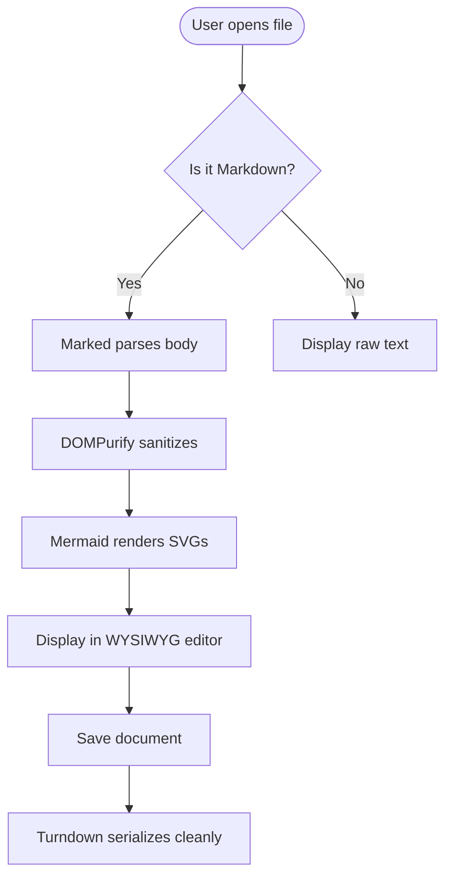
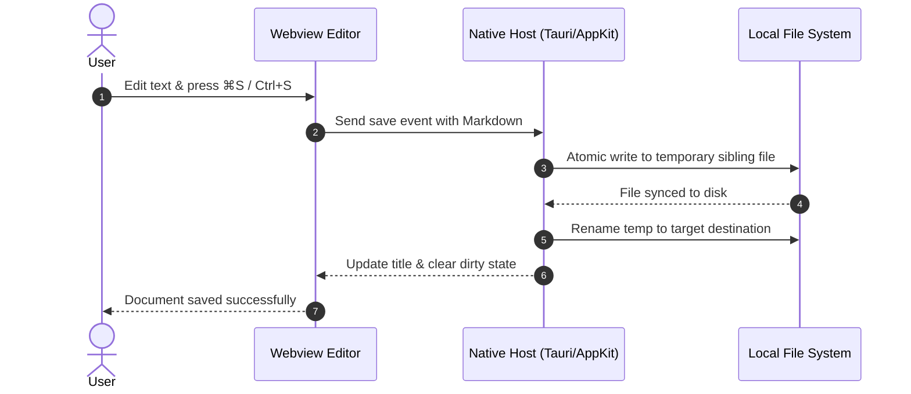

# Diagrams, Callouts & Extended Syntax Showcase

This document tests the visual rendering and two-way roundtripping of **Mermaid diagrams**, **GitHub alert callouts**, and **highlighted text**.

---

## 1. Mermaid Flowchart

---

## 2. Mermaid Sequence Diagram

---

## 3. GitHub Alert Callouts

> [!NOTE]
> **Helpful Note**: Useful information that users should know, even when skimming content.

> [!TIP]
> **Pro Tip**: Helpful advice for doing things better or more easily. Try toggling **Source View** with **⌘⇧M** (Mac) or **Ctrl+Shift+M** (Linux).

> [!IMPORTANT]
> **Crucial Information**: Key information users need to know to achieve their goal.

> [!WARNING]
> **Urgent Info**: Urgent info that needs immediate user attention to avoid problems.

> [!CAUTION]
> **Advises Caution**: Advises of risks or negative outcomes of certain actions.

---

## 4. Text Highlighting

You can highlight important passages using `==text==`:

* This is a ==critical requirement== that must not be overlooked.
* Multiple highlights: ==first item== and ==second item== in the same sentence.
* Combined with bold: ==**very important notice**==.

---

## 5. Roundtrip Test Instructions

1. Switch between **Rich Text** and **Source** view using **⌘⇧M** (or **Ctrl+Shift+M**).
2. Make a small edit in any paragraph above.
3. Save the document with **⌘S** (or **Ctrl+S**).
4. Verify that all diagrams, callouts, and highlights preserve their exact Markdown syntax!

